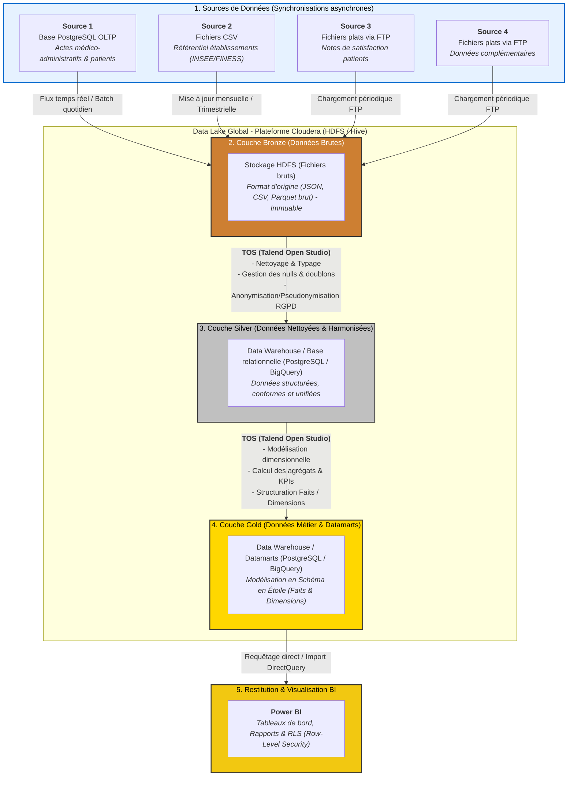

# Bloc 1 : Bloc Stockage et BigData

_Membres :_ 
-   Quenti HAZEMANN
-   Ulysse
-   Franklin 

_Promotion :_ FISA A4 INFO 25-28

_Date :_ 26/10/2026

## Sommaire

- [Bloc 1 : Bloc Stockage et BigData](#bloc-1--bloc-stockage-et-bigdata)
  - [Sommaire](#sommaire)
  - [Introduction du projet](#introduction-du-projet)
  - [Architecture Cible et des Flux de Données](#architecture-cible-et-des-flux-de-données)
    - [Diagramme du flux de données](#diagramme-du-flux-de-données)
    - [Explication du diagramme](#explication-du-diagramme)
    - [1. Les Sources de Données (Synchronisations asynchrones)](#1-les-sources-de-données-synchronisations-asynchrones)
    - [2. Le Data Lake Global – Plateforme Cloudera (HDFS / Hive)](#2-le-data-lake-global--plateforme-cloudera-hdfs--hive)
    - [3. Les Pipelines d'Intégration (TOS - Talend Open Studio)](#3-les-pipelines-dintégration-tos---talend-open-studio)
    - [4. Restitution et Visualisation (Power BI)](#4-restitution-et-visualisation-power-bi)
  - 

## Introduction du projet

## Architecture Cible et des Flux de Données

### Diagramme du flux de données

### Explication du diagramme

L'architecture cible présentée dans ce diagramme repose sur un écosystème Big Data et Business Intelligence unifié, structuré autour d'un grand **Data Lake d'entreprise propulsé par Cloudera (HDFS / Hive)**. Elle permet d'absorber des sources hétérogènes de manière asynchrone, de transformer progressivement la donnée via **TOS (Talend Open Studio)**, et de la restituer de manière sécurisée aux utilisateurs métiers via **Power BI**.

Voici le détail de chaque composant et des flux associés :

---

### 1. Les Sources de Données (Synchronisations asynchrones)
Le système s'alimente à partir de quatre sources distinctes et indépendantes, disposant chacune de leur propre fréquence de synchronisation :
* **Source 1 (Base de données PostgreSQL) :** Gestion des actes médico-administratifs des patients (admissions, consultations, diagnostics, séjours hospitaliers).
* **Source 2 (Fichiers CSV) :** Données exportées relatives à la gestion administrative des établissements hospitaliers de France (capacités, certifications, localisation géographique par code INSEE/FINESS).
* **Source 3 (Fichiers plats via FTP) :** Notes de satisfaction émises par des patients sur différents établissements de santé.
* **Source 4 (Fichiers plats via FTP) :** Données complémentaires.

---

### 2. Le Data Lake Global – Plateforme Cloudera (HDFS / Hive)
L'ensemble des trois couches de transformation réside au sein d'une même infrastructure mutualisée **Cloudera**, exploitant le système de fichiers distribué **HDFS** et l'entrepôt de données **Hive** :
* **Couche Bronze (Données Brutes) :** Espace d'atterrissage (*Landing Zone*). Les données des 4 sources y sont stockées à l'identique dans leur format d'origine (JSON, CSV, fichiers bruts) sous forme immuable pour garantir une traçabilité totale (*Data Lineage*).
* **Couche Silver (Données Nettoyées & Harmonisées) :** Espace intermédiaire où les données brutes sont structurées sous forme de tables Hive propres. Les traitements appliqués nettoient les anomalies, gèrent les valeurs nulles, éliminent les doublons et appliquent les règles de mise en conformité **RGPD** (anonymisation et pseudonymisation des données personnelles).
* **Couche Gold (Données Métier & Datamarts) :** Espace final de modélisation analytique. Les données y sont organisées sous forme de **schéma en étoile** (tables de faits et de dimensions) intégrant les indicateurs clés de performance (KPIs) pré-calculés et prêts à l'emploi.

---

### 3. Les Pipelines d'Intégration (TOS - Talend Open Studio)
L'orchestration et la transformation de la donnée d'une couche à l'autre sont assurées par des jobs **TOS (Talend Open Studio)** :
* **Premier pipeline (Bronze $\rightarrow$ Silver) :** Extraction des fichiers bruts, nettoyage syntaxique, typage, gestion de la qualité des données et application des masques de confidentialité RGPD.
* **Second pipeline (Silver $\rightarrow$ Gold) :** Transformation des tables nettoyées en modèles dimensionnels (schéma en étoile) pour répondre aux axes d'analyse des utilisateurs métiers.

---

### 4. Restitution et Visualisation (Power BI)
* **Power BI** se connecte directement aux tables de la couche Gold du Data Lake. 
* Il permet de concevoir les tableaux de bord et rapports décisionnels interactifs, tout en garantissant la sécurité des données grâce à la mise en place d'une **Row-Level Security (RLS)** pour restreindre l'accès selon les habilitations des utilisateurs.

##

