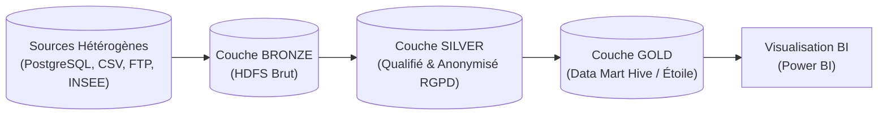
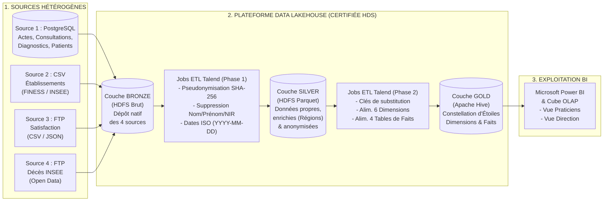

ÉCOLE D'INGÉNIEURS CESI

BLOC STOCKAGE ET BIG DATA — A4 FISA

LIVRABLE 1

RÉFÉRENTIEL DE DONNÉES ET ARCHITECTURE

Conception de l'Entrepôt de Données Décisionnel (EDD) du Groupe CHU (Cloud Healthcare Unit)

  

<strong>Membres du Groupe Projet :</strong> 
Ulysse • Quentin • Jason

## Sommaire

- [1. Introduction \& Cadrage Métier du Projet CHU](#1-introduction--cadrage-métier-du-projet-chu)
  - [1.1. Contexte et Objectifs de la Transformation Digitale](#11-contexte-et-objectifs-de-la-transformation-digitale)
  - [1.2. Inventaire et Qualification des 4 Sources de Données](#12-inventaire-et-qualification-des-4-sources-de-données)
  - [1.3. Recensement Structuré des Besoins Utilisateurs par Profil](#13-recensement-structuré-des-besoins-utilisateurs-par-profil)
    - [A. Profil 1 : Praticiens (Médecins, Chefs de service, Personnel infirmier)](#a-profil-1--praticiens-médecins-chefs-de-service-personnel-infirmier)
    - [B. Profil 2 : Direction d'Établissement (Administrateurs, Contrôle de gestion, Qualité)](#b-profil-2--direction-détablissement-administrateurs-contrôle-de-gestion-qualité)
- [2. Architecture Cible Décisionnelle (Paradigme Lakehouse)](#2-architecture-cible-décisionnelle-paradigme-lakehouse)
  - [2.1. Architecture 3 Couches : Bronze, Silver, Gold (Médaillon)](#21-architecture-3-couches--bronze-silver-gold-médaillon)
  - [2.2. Schéma Global des Flux de Données de Bout en Bout](#22-schéma-global-des-flux-de-données-de-bout-en-bout)
  - [2.3. Préconisations et Justification de la Stack Technologique](#23-préconisations-et-justification-de-la-stack-technologique)
    - [A. Brique d'Intégration (ETL / ELT)](#a-brique-dintégration-etl--elt)
    - [B. Brique de Stockage et Moteur Analytique](#b-brique-de-stockage-et-moteur-analytique)
    - [C. Brique de Visualisation (Business Intelligence)](#c-brique-de-visualisation-business-intelligence)
- [3. Modélisation Conceptuelle et Logique du Schéma Décisionnel](#3-modélisation-conceptuelle-et-logique-du-schéma-décisionnel)
  - [3.1. Méthodologie retenue : Approche Kimball (Constellation d'Étoiles)](#31-méthodologie-retenue--approche-kimball-constellation-détoiles)
  - [3.2. Modèle Logique Global (Schéma en Constellation d'Étoiles)](#32-modèle-logique-global-schéma-en-constellation-détoiles)
  - [3.3. Dictionnaire de Données Complet](#33-dictionnaire-de-données-complet)
    - [A. Tables de Dimensions (Axes d'Analyse)](#a-tables-de-dimensions-axes-danalyse)
      - [1. Table `DIM_TEMPS` (Calendrier unique partagé)](#1-table-dim_temps-calendrier-unique-partagé)
      - [2. Table `DIM_LOCALISATION_INSEE` (Référentiel Géographique \& Régions)](#2-table-dim_localisation_insee-référentiel-géographique--régions)
      - [3. Table `DIM_ETABLISSEMENT` (Hôpitaux et structures de soins — Source 2)](#3-table-dim_etablissement-hôpitaux-et-structures-de-soins--source-2)
      - [4. Table `DIM_PATIENT` (Patient anonymisé — Sources 1 \& 4)](#4-table-dim_patient-patient-anonymisé--sources-1--4)
      - [5. Table `DIM_DIAGNOSTIC` (Pathologies — Source 1)](#5-table-dim_diagnostic-pathologies--source-1)
      - [6. Table `DIM_PROFESSIONNEL` (Praticiens et soignants — Source 1)](#6-table-dim_professionnel-praticiens-et-soignants--source-1)
    - [B. Tables de Faits (Mesures et Événements)](#b-tables-de-faits-mesures-et-événements)
      - [1. Table `FAIT_CONSULTATIONS` (Source 1 + Source 2)](#1-table-fait_consultations-source-1--source-2)
      - [2. Table `FAIT_HOSPITALISATIONS` (Source 1 + Source 2)](#2-table-fait_hospitalisations-source-1--source-2)
      - [3. Table `FAIT_SATISFACTION` (Source 3 + Source 2)](#3-table-fait_satisfaction-source-3--source-2)
      - [4. Table `FAIT_DECES` (Source 4 : Open Data INSEE)](#4-table-fait_deces-source-4--open-data-insee)
  - [3.4. Matrice de Couverture des Indicateurs Métiers](#34-matrice-de-couverture-des-indicateurs-métiers)
- [4. Spécifications Fonctionnelles des Jobs ETL](#4-spécifications-fonctionnelles-des-jobs-etl)
  - [4.1. Architecture d'Alimentation et Ordonnancement](#41-architecture-dalimentation-et-ordonnancement)
  - [4.2. Règles de Transformation, Formatage et Enrichissement](#42-règles-de-transformation-formatage-et-enrichissement)
  - [4.3. Gestion des Valeurs Nulles, des Doublons, des Erreurs et des Rejets](#43-gestion-des-valeurs-nulles-des-doublons-des-erreurs-et-des-rejets)
  - [4.4. Planification et Fréquence d'Exécution des Flux](#44-planification-et-fréquence-dexécution-des-flux)
- [5. Plan de Gouvernance des Données et Sécurité (RGPD \& HDS)](#5-plan-de-gouvernance-des-données-et-sécurité-rgpd--hds)
  - [5.1. Conformité RGPD : Minimisation, Pseudonymisation et Anonymisation](#51-conformité-rgpd--minimisation-pseudonymisation-et-anonymisation)
  - [5.2. Conformité HDS (Hébergeur de Données de Santé) et Sécurité Infrastructure](#52-conformité-hds-hébergeur-de-données-de-santé-et-sécurité-infrastructure)
  - [5.3. Gestion des Rôles et Droits d'Accès (Matrice RBAC)](#53-gestion-des-rôles-et-droits-daccès-matrice-rbac)
  - [5.4. Traçabilité des Flux (Data Lineage) et Cycle de Vie des Données](#54-traçabilité-des-flux-data-lineage-et-cycle-de-vie-des-données)
- [Conclusion](#conclusion)

# 1. Introduction & Cadrage Métier du Projet CHU

## 1.1. Contexte et Objectifs de la Transformation Digitale
Dans le cadre de la modernisation du secteur hospitalier français, le groupe **CHU (Cloud Healthcare Unit)** souhaite valoriser le volume massif de données générées par les systèmes d'information opérationnels du groupe **HCG** ainsi que par des sources externes (référentiels nationaux et fichiers distribués via FTP).

L'objectif de ce premier livrable est de définir l'architecture complète et le référentiel de données d'un **Entrepôt de Données Décisionnel (EDD)** unifié, permettant de :
* Centraliser et croiser des sources de données fortement hétérogènes (bases SQL, fichiers plats CSV/JSON, Open Data INSEE).
* Répondre aux besoins analytiques de deux grands profils d'utilisateurs : les **Praticiens** (médecins, cadres infirmiers) et la **Direction d'établissement** (administrateurs, décideurs).
* Garantir un haut niveau de **performance analytique (OLAP)**, d'**élasticité**, un excellent **ratio coût-efficacité**, ainsi qu'une conformité stricte au **RGPD** et à la certification **HDS (Hébergeur de Données de Santé)**.

## 1.2. Inventaire et Qualification des 4 Sources de Données

L'audit initial met en évidence **4 sources de données disparates** couvrant plusieurs années d'historique :

| Réf. | Source de Données | Format & Protocole | Nature des Données | Volumétrie & Vélocité | Sensibilité RGPD / HDS |
| :--- | :--- | :--- | :--- | :--- | :--- |
| **Source 1** | **Base opérationnelle PostgreSQL (HCG)** | Relationnel SQL (OLTP) | Actes médico-administratifs : admissions, consultations, diagnostics, séjours hospitaliers, patients, professionnels. | Élevée (Plusieurs années d'historique transactionnel) | **Critique (Art. 9 RGPD)** : Données médicales et identifiantes patients. |
| **Source 2** | **Référentiel Établissements** | Fichiers plats **CSV** (Export local) | Gestion administrative des hôpitaux de France : numéro FINESS, capacités, certifications, code INSEE / localisation. | Faible à Moyenne (Référentiel statique / mise à jour périodique) | **Aucune** (Données administratives publiques d'établissements). |
| **Source 3** | **Enquêtes de Satisfaction** | Fichiers plats **CSV / JSON** via **FTP** | Notes de satisfaction émises par les usagers par établissement de santé et par période (ex: année 2020). | Moyenne (Collecte périodique par campagnes) | **Modérée** : Vérifier l'absence de données nominatives dans les commentaires. |
| **Source 4** | **Répertoire National des Décès (INSEE)** | Fichiers plats **CSV** Open Data via **FTP** | Décès enregistrés en France (sexe, date de naissance, date et commune/région INSEE de décès, notamment 2019). | Élevée (~600 000 lignes / an en France) | **Faible (Open Data)** : Données publiques de personnes décédées, mais à agréger par région. |

## 1.3. Recensement Structuré des Besoins Utilisateurs par Profil

Afin de concevoir un modèle dimensionnel pertinent, nous avons segmenté les besoins analytiques selon les deux catégories d'utilisateurs cibles :

### A. Profil 1 : Praticiens (Médecins, Chefs de service, Personnel infirmier)
* **Objectif métier :** Suivre la pathologie des patients, évaluer la charge de travail médicale par spécialité/professionnel et adapter les protocoles de soins selon le profil démographique (âge, sexe) et épidémiologique.
* **Indicateurs (KPI) attendus :**
  * **KPI-P1 :** Taux et volume de consultation des patients par rapport à un **diagnostic *X*** sur une **période de temps *Y***.
  * **KPI-P2 :** Taux et volume d'hospitalisation des patients par rapport à des **diagnostics** sur une **période donnée**.
  * **KPI-P3 :** Taux d'hospitalisation ventilé par **sexe** et par **tranche d'âge**.
  * **KPI-P4 :** Taux et volume de consultation par **professionnel de santé** (et par spécialité).
  * **KPI-P5 :** Nombre de **décès** par localisation (**région INSEE**) et par période (focus année 2019).

### B. Profil 2 : Direction d'Établissement (Administrateurs, Contrôle de gestion, Qualité)
* **Objectif métier :** Piloter l'affluence hospitalière, optimiser le taux d'occupation des lits, comparer la performance entre établissements/régions et mesurer la qualité perçue par les usagers.
* **Indicateurs (KPI) attendus :**
  * **KPI-D1 :** Taux de consultation des patients dans un **établissement *X*** sur une **période de temps *Y***.
  * **KPI-D2 :** Taux global d'hospitalisation des patients sur une **période donnée *Y*** (et durée moyenne de séjour).
  * **KPI-D3 :** Taux global de **satisfaction des usagers** par établissement et par **région** (focus année 2020).

# 2. Architecture Cible Décisionnelle (Paradigme Lakehouse)

## 2.1. Architecture 3 Couches : Bronze, Silver, Gold (Médaillon)

Pour concilier la variété des sources (SQL, CSV, FTP) avec la rigueur d'un entrepôt décisionnel gouverné, nous retenons une architecture **Data Lakehouse en 3 couches (Architecture Médaillon)** déployée sur un cluster distribué **Cloudera Hadoop (HDFS + Apache Hive)** selon une logique **ELT / ETL hybride** :

1. **Couche BRONZE (Zone Brute / *Raw Ingestion Zone* — HDFS) :**
   * **Rôle :** Réceptionner à l'identique les extractions brutes issues de PostgreSQL, des fichiers CSV locaux et des serveurs FTP (Satisfaction et Décès INSEE).
   * **Caractéristique :** *Schema-on-Read*. Conservation de l'historique brut en format natif horodaté pour permettre le rejeu en cas d'évolution des règles métiers. Accès strictement interdit aux utilisateurs finaux (chiffrement disque actif).
2. **Couche SILVER (Zone Qualifiée & Anonymisée / *Trusted Zone* — HDFS Parquet) :**
   * **Rôle :** Stocker les données nettoyées, dédoublonnées, typées (dates converties au standard ISO `YYYY-MM-DD`), enrichies (correspondance Code INSEE / FINESS &rarr; Région) et **anonymisées/pseudonymisées conformément au RGPD**.
   * **Caractéristique :** Fichiers stockés au format colonnaire compressé **Apache Parquet**, garantissant une lecture rapide et l'absence totale de données nominatives directes.
3. **Couche GOLD (Zone Décisionnelle / *Curated Data Mart* — Apache Hive / SGBD Analytique) :**
   * **Rôle :** Exposer le **Modèle Dimensionnel en Étoile (Constellation Kimball)** composé des Tables de Dimensions et des Tables de Faits agrégées, partitionnées et indexées.
   * **Caractéristique :** *Schema-on-Write*. Alimente directement l'outil de Business Intelligence (**Microsoft Power BI**) pour les tableaux de bord des praticiens et de la direction.

## 2.2. Schéma Global des Flux de Données de Bout en Bout

## 2.3. Préconisations et Justification de la Stack Technologique

Afin de respecter les exigences non fonctionnelles (**ratio coût-efficacité**, **sécurité RGPD/HDS**, **élasticité** et **scalabilité**), nous avons comparé les solutions du marché pour chaque brique de l'architecture :

### A. Brique d'Intégration (ETL / ELT)
| Outil évalué | Avantages | Inconvénients | Choix & Justification |
| :--- | :--- | :--- | :--- |
| **Talend Open Studio for Big Data** | • Connecteurs natifs PostgreSQL, FTP, CSV, JSON, HDFS et Hive. • Composant `tMap` idéal pour les jointures FINESS/INSEE et l'anonymisation. • Génération de code Java/MapReduce sans coût de licence. | • Interface lourde en mémoire sur le poste développeur. | **RETENU** Excellent ratio coût-efficacité (Open Source), maîtrise rapide et gestion native des rejets et de la qualité des données. |
| **Apache NiFi** | • Excellent pour le routage de flux en temps réel (Streaming). | • Moins adapté aux transformations relationnelles complexes et jointures multi-sources en étoile. | Écarté (Utilisé uniquement en complément si flux temps réel futur). |
| **dbt (data build tool)** | • Parfait pour les transformations SQL dans l'entrepôt (T de l'ELT). | • Ne gère pas l'extraction depuis FTP/CSV ni l'anonymisation avant chargement. | Écarté pour l'ingestion initiale. |
| **Python** | • Flexibilité totale : gestion de tous les types de fichiers. • Adapté à toutes les étapes de la chaîne de traitement (Bronze, Silver, Gold). | • Nécessite de maintenir du code source. • Gestion manuelle des exceptions et des rejets. | **RETENU** Idéale pour orchestrer les pipelines personnalisés et couvrir le cycle complet du nettoyage à l'agrégation.

### B. Brique de Stockage et Moteur Analytique
| Outil évalué | Avantages | Inconvénients | Choix & Justification |
| :--- | :--- | :--- | :--- |
| **HDFS + Apache Hive (avec stockage Parquet)** | • Scalabilité horizontale (*Scale-out*) sur cluster. • Tolérance aux pannes (réplication x3). • Requêtage SQL standard (HiveQL) avec **partitionnement** et **bucketing**. | • Latence légèrement supérieure sur de très petits volumes si non optimisé (Tez/Spark requis). | **RETENU (Cible Big Data)** Permet de gérer à la fois le Data Lake (Bronze/Silver sur HDFS) et le Data Warehouse (Gold sous Hive). *(Compatible avec une implémentation PostgreSQL analytique partitionnée en environnement restreint).* |
| **Google BigQuery / Snowflake** | • Serverless ultra-rapide et élastique. | • Coût facturé à la requête et contraintes fortes de souveraineté Cloud Act / HDS. | Écarté (Risque budgétaire et réglementaire HDS). |

### C. Brique de Visualisation (Business Intelligence)
| Outil évalué | Avantages | Inconvénients | Choix & Justification |
| :--- | :--- | :--- | :--- |
| **Microsoft Power BI** | • Connecteurs natifs Hive / PostgreSQL. • Moteur colonnaire en mémoire (*VertiPaq*) ultra-rapide. • Gestion fine de la sécurité par profil (**RLS - Row-Level Security** : Praticiens vs Direction). | • Licence Pro requise pour le partage Cloud, mais gratuit en version Desktop pour la maquette. | **RETENU** Ergonomie supérieure pour le *Data Storytelling*, cartes géographiques natives par région INSEE et filtrage dynamique. |
| **Apache Superset / Metabase** | • Open Source et léger en mode Web. | • Moins riche pour la modélisation DAX et le storytelling avancé. | Solution de repli secondaire. |

# 3. Modélisation Conceptuelle et Logique du Schéma Décisionnel

## 3.1. Méthodologie retenue : Approche Kimball (Constellation d'Étoiles)

L'analyse des besoins utilisateurs met en évidence **4 processus métiers distincts** (les Consultations, les Hospitalisations, la Satisfaction usagers et la Mortalité INSEE) qui n'ont pas la même granularité :
* Une **Consultation** et une **Hospitalisation** ont une granularité fine au niveau de l'*acte patient / professionnel / diagnostic / établissement / jour*.
* La **Satisfaction** est mesurée au niveau *établissement / enquête / période* (sans diagnostic ni professionnel).
* Les **Décès (INSEE)** sont mesurés au niveau *individu décédé / commune-région INSEE / date* (sans établissement hospitalier ni professionnel).

> **Justification du choix de modélisation :**  
> Plutôt que de créer une table de faits unique qui contiendrait une majorité de valeurs `NULL` (anti-pattern), nous appliquons la méthodologie **Ralph Kimball** en concevant un **Modèle en Constellation d'Étoiles (Fact Constellation)** composé de **4 Tables de Faits** partageant **6 Tables de Dimensions Conformes** (dénormalisées pour minimiser les jointures `JOIN` et maximiser les performances de lecture OLAP).

## 3.2. Modèle Logique Global (Schéma en Constellation d'Étoiles)

```mermaid
%%{init: {'er': {'layoutDirection': 'LR', 'entityPadding': 8, 'fontSize': 11}} }%%
erDiagram
    DIM_TEMPS ||--o{ FAIT_CONSULTATIONS : "id_temps"
    DIM_TEMPS ||--o{ FAIT_HOSPITALISATIONS : "id_temps_entree"
    DIM_TEMPS ||--o{ FAIT_SATISFACTION : "id_temps"
    DIM_TEMPS ||--o{ FAIT_DECES : "id_temps_deces"

    DIM_ETABLISSEMENT ||--o{ FAIT_CONSULTATIONS : "id_etablissement"
    DIM_ETABLISSEMENT ||--o{ FAIT_HOSPITALISATIONS : "id_etablissement"
    DIM_ETABLISSEMENT ||--o{ FAIT_SATISFACTION : "id_etablissement"

    DIM_LOCALISATION_INSEE ||--o{ FAIT_CONSULTATIONS : "id_localisation"
    DIM_LOCALISATION_INSEE ||--o{ FAIT_HOSPITALISATIONS : "id_localisation"
    DIM_LOCALISATION_INSEE ||--o{ FAIT_SATISFACTION : "id_localisation"
    DIM_LOCALISATION_INSEE ||--o{ FAIT_DECES : "id_localisation"

    DIM_PATIENT ||--o{ FAIT_CONSULTATIONS : "id_patient"
    DIM_PATIENT ||--o{ FAIT_HOSPITALISATIONS : "id_patient"
    DIM_PATIENT ||--o{ FAIT_DECES : "id_patient"

    DIM_DIAGNOSTIC ||--o{ FAIT_CONSULTATIONS : "id_diagnostic"
    DIM_DIAGNOSTIC ||--o{ FAIT_HOSPITALISATIONS : "id_diagnostic"

    DIM_PROFESSIONNEL ||--o{ FAIT_CONSULTATIONS : "id_professionnel"
    DIM_PROFESSIONNEL ||--o{ FAIT_HOSPITALISATIONS : "id_professionnel"

    DIM_TEMPS {
        int id_temps PK
        date date_complete
        smallint jour
        smallint mois
        varchar nom_mois
        smallint trimestre
        smallint semestre
        smallint annee
    }

    DIM_LOCALISATION_INSEE {
        int id_localisation PK
        varchar code_insee_commune
        varchar code_postal
        varchar nom_commune
        varchar code_departement
        varchar nom_departement
        varchar code_region
        varchar nom_region
    }

    DIM_ETABLISSEMENT {
        int id_etablissement PK
        varchar code_finess
        varchar nom_etablissement
        varchar type_etablissement
        int capacite_lits
        varchar niveau_certification
        varchar code_insee_commune
        varchar nom_region
    }

    DIM_PATIENT {
        int id_patient PK
        varchar hash_patient_rgpd
        char sexe
        smallint annee_naissance
        smallint age_calcule
        varchar tranche_age
    }

    DIM_DIAGNOSTIC {
        int id_diagnostic PK
        varchar code_diagnostic
        varchar libelle_diagnostic
        varchar categorie_pathologie
    }

    DIM_PROFESSIONNEL {
        int id_professionnel PK
        varchar hash_id_pro
        varchar specialite
        varchar fonction
    }

    FAIT_CONSULTATIONS {
        bigint id_fait_consultation PK
        int id_temps FK
        int id_etablissement FK
        int id_localisation FK
        int id_patient FK
        int id_diagnostic FK
        int id_professionnel FK
        int nb_consultations
        decimal duree_consultation_min
    }

    FAIT_HOSPITALISATIONS {
        bigint id_fait_hospitalisation PK
        int id_temps_entree FK
        int id_etablissement FK
        int id_localisation FK
        int id_patient FK
        int id_diagnostic FK
        int id_professionnel FK
        int nb_hospitalisations
        int duree_sejour_jours
    }

    FAIT_SATISFACTION {
        bigint id_fait_satisfaction PK
        int id_temps FK
        int id_etablissement FK
        int id_localisation FK
        decimal note_satisfaction
        int nb_repondants
    }

    FAIT_DECES {
        bigint id_fait_deces PK
        int id_temps_deces FK
        int id_localisation FK
        int id_patient FK
        int nb_deces
        smallint age_deces
    }
```

## 3.3. Dictionnaire de Données Complet

### A. Tables de Dimensions (Axes d'Analyse)

#### 1. Table `DIM_TEMPS` (Calendrier unique partagé)
| Nom de l'attribut | Type Logique / Physique | Clé / Contrainte | Cardinalité vers Faits | Description & Règle de gestion |
| :--- | :--- | :--- | :--- | :--- |
| `id_temps` | `INT` | **PK** (`NOT NULL`) | `1..1` &rarr; `0..N` | Clé technique au format `AAAAMMJJ` (ex: `20200514`). |
| `date_complete` | `DATE` | `NOT NULL` | - | Date au standard ISO `YYYY-MM-DD` (compatible Hive/SQL). |
| `jour` | `SMALLINT` | `NOT NULL` | - | Numéro du jour dans le mois (`1` à `31`). |
| `mois` | `SMALLINT` | `NOT NULL` | - | Numéro du mois (`1` à `12`). |
| `nom_mois` | `VARCHAR(20)` | `NOT NULL` | - | Libellé du mois (`Janvier` à `Décembre`). |
| `trimestre` | `SMALLINT` | `NOT NULL` | - | Numéro du trimestre (`1` à `4`). |
| `semestre` | `SMALLINT` | `NOT NULL` | - | Numéro du semestre (`1` ou `2`). |
| `annee` | `SMALLINT` | `NOT NULL` | - | Année sur 4 chiffres (ex: `2019`, `2020`). |

#### 2. Table `DIM_LOCALISATION_INSEE` (Référentiel Géographique & Régions)
| Nom de l'attribut | Type Logique / Physique | Clé / Contrainte | Cardinalité vers Faits | Description & Règle de gestion |
| :--- | :--- | :--- | :--- | :--- |
| `id_localisation` | `INT` | **PK** (`NOT NULL`) | `1..1` &rarr; `0..N` | Clé technique auto-incrémentée (*Surrogate Key*). |
| `code_insee_commune`| `VARCHAR(10)` | `NOT NULL` | - | Code officiel géographique INSEE de la commune (5 car.). |
| `code_postal` | `VARCHAR(10)` | `NULL` | - | Code postal associé. |
| `nom_commune` | `VARCHAR(100)`| `NOT NULL` | - | Nom de la ville / commune. |
| `code_departement` | `VARCHAR(5)` | `NOT NULL` | - | Numéro de département (`01` à `95`, `2A`, `2B`, `971`...). |
| `nom_departement` | `VARCHAR(100)`| `NOT NULL` | - | Nom du département. |
| `code_region` | `VARCHAR(5)` | `NOT NULL` | - | Code INSEE de la région. |
| `nom_region` | `VARCHAR(100)`| `NOT NULL` | - | **Axe majeur :** Nom de la région (ex: *Auvergne-Rhône-Alpes*). |

#### 3. Table `DIM_ETABLISSEMENT` (Hôpitaux et structures de soins — Source 2)
| Nom de l'attribut | Type Logique / Physique | Clé / Contrainte | Cardinalité vers Faits | Description & Règle de gestion |
| :--- | :--- | :--- | :--- | :--- |
| `id_etablissement` | `INT` | **PK** (`NOT NULL`) | `1..1` &rarr; `0..N` | Clé technique auto-incrémentée. |
| `code_finess` | `VARCHAR(20)` | `UNIQUE NOT NULL`| - | Identifiant national FINESS de l'établissement. |
| `nom_etablissement`| `VARCHAR(200)`| `NOT NULL` | - | Raison sociale de l'hôpital / clinique. |
| `type_etablissement`| `VARCHAR(100)`| `NULL` | - | Catégorie (CHU, CH, Clinique privée, EHPAD...). |
| `capacite_lits` | `INT` | `DEFAULT 0` | - | Capacité d'accueil en nombre de lits installés. |
| `niveau_certification`| `VARCHAR(50)`| `NULL` | - | Niveau de certification HAS. |
| `code_insee_commune`| `VARCHAR(10)` | `NOT NULL` | - | Code INSEE (permet la liaison géographique). |
| `nom_region` | `VARCHAR(100)`| `NOT NULL` | - | Région dénormalisée pour accélérer les requêtes par établissement. |

#### 4. Table `DIM_PATIENT` (Patient anonymisé — Sources 1 & 4)
| Nom de l'attribut | Type Logique / Physique | Clé / Contrainte | Cardinalité vers Faits | Description & Règle de gestion |
| :--- | :--- | :--- | :--- | :--- |
| `id_patient` | `INT` | **PK** (`NOT NULL`) | `1..1` &rarr; `0..N` | Clé technique interne à l'entrepôt. |
| `hash_patient_rgpd`| `VARCHAR(64)` | `UNIQUE NOT NULL`| - | Empreinte **SHA-256 salée** de l'ID source (Pseudonymisation RGPD). |
| `sexe` | `CHAR(1)` | `NOT NULL` | - | Sexe normalisé : `'M'`, `'F'` ou `'I'` (Inconnu). |
| `annee_naissance` | `SMALLINT` | `NULL` | - | Année de naissance uniquement (jour/mois supprimés pour le RGPD). |
| `age_calcule` | `SMALLINT` | `NULL` | - | Âge au moment des faits. |
| `tranche_age` | `VARCHAR(20)` | `NOT NULL` | - | **Généralisation RGPD :** `0-17`, `18-29`, `30-44`, `45-59`, `60-74`, `75+`. |

#### 5. Table `DIM_DIAGNOSTIC` (Pathologies — Source 1)
| Nom de l'attribut | Type Logique / Physique | Clé / Contrainte | Cardinalité vers Faits | Description & Règle de gestion |
| :--- | :--- | :--- | :--- | :--- |
| `id_diagnostic` | `INT` | **PK** (`NOT NULL`) | `1..1` &rarr; `0..N` | Clé technique auto-incrémentée. |
| `code_diagnostic` | `VARCHAR(20)` | `UNIQUE NOT NULL`| - | Code médical de la pathologie (nomenclature CIM-10). |
| `libelle_diagnostic`| `VARCHAR(255)`| `NOT NULL` | - | Description médicale du diagnostic. |
| `categorie_pathologie`| `VARCHAR(100)`| `NULL` | - | Famille de pathologie (Cardiologie, Pneumologie, Traumatologie...). |

#### 6. Table `DIM_PROFESSIONNEL` (Praticiens et soignants — Source 1)
| Nom de l'attribut | Type Logique / Physique | Clé / Contrainte | Cardinalité vers Faits | Description & Règle de gestion |
| :--- | :--- | :--- | :--- | :--- |
| `id_professionnel` | `INT` | **PK** (`NOT NULL`) | `1..1` &rarr; `0..N` | Clé technique auto-incrémentée. |
| `hash_id_pro` | `VARCHAR(64)` | `UNIQUE NOT NULL`| - | Identifiant matricule / RPPS pseudonymisé. |
| `specialite` | `VARCHAR(100)`| `NOT NULL` | - | Spécialité médicale exercée. |
| `fonction` | `VARCHAR(100)`| `NULL` | - | Catégorie (Médecin, Chirurgien, Infirmier...). |

### B. Tables de Faits (Mesures et Événements)

#### 1. Table `FAIT_CONSULTATIONS` (Source 1 + Source 2)
* **Granularité :** Une ligne par acte de consultation réalisé.
* **Clé primaire :** `id_fait_consultation` (`BIGINT`) ou clé composite des clés étrangères.
* **Clés étrangères (`NOT NULL`, Cardinalité `0..N` &rarr; `1..1`) :** `#id_temps`, `#id_etablissement`, `#id_localisation`, `#id_patient`, `#id_diagnostic`, `#id_professionnel`.
* **Mesures additives :**
  * `nb_consultations` (`INT`, valeur `1` par acte pour sommation `SUM`/`COUNT`).
  * `duree_consultation_min` (`DECIMAL(6,2)`, durée de l'acte en minutes).

#### 2. Table `FAIT_HOSPITALISATIONS` (Source 1 + Source 2)
* **Granularité :** Une ligne par séjour d'hospitalisation.
* **Clés étrangères (`NOT NULL`, Cardinalité `0..N` &rarr; `1..1`) :** `#id_temps_entree`, `#id_etablissement`, `#id_localisation`, `#id_patient`, `#id_diagnostic`, `#id_professionnel`.
* **Mesures additives :**
  * `nb_hospitalisations` (`INT`, valeur `1` par séjour).
  * `duree_sejour_jours` (`INT`, calculée via `Date_Sortie - Date_Entree` dans l'ETL).

#### 3. Table `FAIT_SATISFACTION` (Source 3 + Source 2)
* **Granularité :** Une ligne par évaluation de satisfaction d'un établissement sur une période.
* **Clés étrangères (`NOT NULL`, Cardinalité `0..N` &rarr; `1..1`) :** `#id_temps`, `#id_etablissement`, `#id_localisation`.
* **Mesures :**
  * `note_satisfaction` (`DECIMAL(5,2)`, score sur 100 ou sur 10 — semi-additif : agrégé par moyenne `AVG`).
  * `nb_repondants` (`INT`, nombre de questionnaires exprimés — additif `SUM`).

#### 4. Table `FAIT_DECES` (Source 4 : Open Data INSEE)
* **Granularité :** Une ligne par décès déclaré en France (ou pré-agrégé par jour/commune/sexe/tranche d'âge).
* **Clés étrangères (`NOT NULL`, Cardinalité `0..N` &rarr; `1..1`) :** `#id_temps_deces`, `#id_localisation`, `#id_patient` (profil démographique sexe/tranche d'âge).
* **Mesures :**
  * `nb_deces` (`INT`, valeur `1` par décès enregistré — additif `SUM`).
  * `age_deces` (`SMALLINT`, âge au moment du décès — agrégé par moyenne `AVG`).

## 3.4. Matrice de Couverture des Indicateurs Métiers

| Besoin Utilisateur (Cahier des Charges) | Table de Faits sollicitée | Dimensions jointes (`JOIN`) | Formule Analytique SQL / BI |
| :--- | :--- | :--- | :--- |
| **1. Taux de consultation dans un établissement X sur période Y** | `FAIT_CONSULTATIONS` | `DIM_ETABLISSEMENT`, `DIM_TEMPS` | `SUM(nb_consultations) / Total_Consultations_Periode * 100` |
| **2. Taux de consultation par diagnostic X sur période Y** | `FAIT_CONSULTATIONS` | `DIM_DIAGNOSTIC`, `DIM_TEMPS` | `SUM(nb_consultations) [Diag X] / Total_Consultations_Periode * 100` |
| **3. Taux global d'hospitalisation sur une période Y** | `FAIT_HOSPITALISATIONS` | `DIM_TEMPS` | `SUM(nb_hospitalisations) / Population_Patients_Actifs * 100` |
| **4. Taux d'hospitalisation par diagnostic sur période Y** | `FAIT_HOSPITALISATIONS` | `DIM_DIAGNOSTIC`, `DIM_TEMPS` | `SUM(nb_hospitalisations) [Diag X] / Total_Hospit_Periode * 100` |
| **5. Taux d'hospitalisation par sexe et par âge** | `FAIT_HOSPITALISATIONS` | `DIM_PATIENT` (`sexe`, `tranche_age`) | `SUM(nb_hospitalisations)` groupé par `sexe` et `tranche_age` |
| **6. Taux de consultation par professionnel** | `FAIT_CONSULTATIONS` | `DIM_PROFESSIONNEL` | `SUM(nb_consultations)` groupé par `id_professionnel` / `specialite` |
| **7. Nombre de décès par région sur l'année 2019** | `FAIT_DECES` | `DIM_LOCALISATION_INSEE`, `DIM_TEMPS` | `SUM(nb_deces)` avec `WHERE annee = 2019 GROUP BY nom_region` |
| **8. Taux global de satisfaction par région sur l'année 2020** | `FAIT_SATISFACTION` | `DIM_LOCALISATION_INSEE`, `DIM_ETABLISSEMENT`, `DIM_TEMPS` | `AVG(note_satisfaction)` pondéré par `nb_repondants` (`WHERE annee = 2020`) |

# 4. Spécifications Fonctionnelles des Jobs ETL

## 4.1. Architecture d'Alimentation et Ordonnancement
Afin de garantir l'intégrité référentielle dans la couche Gold (Apache Hive / PostgreSQL), l'orchestration des jobs ETL sous **Talend Open Studio** suit un séquencement strict en **3 phases** :

```mermaid
flowchart LR
    subgraph P1 ["Étape 1 : Ingestion & Qualification"]
        J0["Job 00 : Récupération FTP & SQL\nDépôt Couche BRONZE\nQualification & Passage en SILVER"]
    end

    subgraph P2 ["Étape 2 : Chargement des Dimensions (Parallélisable)"]
        JD1["Job 01 : Alim DIM_TEMPS"]
        JD2["Job 02 : Alim DIM_LOCALISATION_INSEE"]
        JD3["Job 03 : Alim DIM_ETABLISSEMENT"]
        JD4["Job 04 : Alim DIM_PATIENT (Anonymisé)"]
        JD5["Job 05 : Alim DIM_DIAGNOSTIC"]
        JD6["Job 06 : Alim DIM_PROFESSIONNEL"]
    end

    subgraph P3 ["Étape 3 : Chargement des Tables de Faits"]
        JF1["Job 07 : Alim FAIT_CONSULTATIONS"]
        JF2["Job 08 : Alim FAIT_HOSPITALISATIONS"]
        JF3["Job 09 : Alim FAIT_SATISFACTION"]
        JF4["Job 10 : Alim FAIT_DECES"]
    end

    P1 --> P2 --> P3
```

## 4.2. Règles de Transformation, Formatage et Enrichissement

| ID Règle | Champ / Flux concerné | Problématique Source | Règle de Transformation Fonctionnelle (Composant Talend `tMap`) |
| :--- | :--- | :--- | :--- |
| **RT-01** | **Enrichissement Régional** (Sources 1, 2, 3, 4) | La région n'est pas directement présente dans les tables d'actes ou d'établissements. | Jointure (*Lookup*) sur le `code_insee` ou les 2 premiers caractères du `code_postal` avec le référentiel officiel INSEE des communes/départements/régions pour injecter `nom_region`. |
| **RT-02** | **Normalisation des Dates** (Toutes les sources) | Formats hétérogènes (`DD/MM/YYYY`, `YYYYMMDD`, texte) incompatibles avec Hive. | Conversion systématique au format ISO **`YYYY-MM-DD`** via `TalendDate.parseDate()` et génération de la clé entière `id_temps = AAAAMMJJ`. |
| **RT-03** | **Pseudonymisation & Âge** (`DIM_PATIENT`) | Présence de Nom, Prénom, Date de naissance exacte et NIR dans PostgreSQL / INSEE. | 1. Suppression des colonnes `Nom`, `Prenom`, `Adresse`, `NIR`. 2. Hachage salé de l'ID : `SHA256(id_patient_source + sel_secret)`. 3. Calcul de l'âge et affectation dans `tranche_age` (`0-17`, `18-29`, `30-44`, `45-59`, `60-74`, `75+`). |
| **RT-04** | **Harmonisation du Sexe** (`DIM_PATIENT`) | Codage disparate (`1`/`2` dans INSEE, `H`/`F` ou `M`/`F` dans PostgreSQL). | Transcodification via `tReplace` / `tMap` : `'1'` ou `'H'` &rarr; `'M'` ; `'2'` ou `'F'` &rarr; `'F'` ; sinon `'I'`. |
| **RT-05** | **Calcul Durée de Séjour** (`FAIT_HOSPITALISATIONS`) | Seules les dates d'entrée et de sortie sont présentes dans PostgreSQL. | Calcul : `TalendDate.diffDate(date_sortie, date_entree, "dd")`. Si la sortie a lieu le même jour (ambulatoire), forcer `duree_sejour_jours = 1`. |
| **RT-06** | **Normalisation Code FINESS** (`DIM_ETABLISSEMENT`) | Codes FINESS parfois sur 8 caractères (zéro initial tronqué par CSV/Excel). | Formatage `StringHandling.LPAD(code_finess, 9, "0")` et `TRIM()` pour garantir la jointure exacte entre PostgreSQL, le CSV Établissements et le FTP Satisfaction. |

## 4.3. Gestion des Valeurs Nulles, des Doublons, des Erreurs et des Rejets

1. **Gestion des Doublons (Unicité) :**
   * Utilisation systématique du composant **`tUniqRow`** sur les clés naturelles avant insertion dans les dimensions (`code_finess` pour Établissement, `code_diagnostic` pour Diagnostic, `hash_patient_rgpd` pour Patient, `id_acte` pour les Consultations/Hospitalisations).
2. **Gestion des Valeurs Nulles (Complétude) :**
   * **Clés étrangères manquantes dans les faits :** Si une consultation fait référence à un diagnostic ou à un établissement non renseigné (`NULL`) ou absent du référentiel, on ne supprime pas l'acte médical (ce qui fausserait le volume global de consultations !). On le rattache à une **ligne technique par défaut** créée dans chaque dimension avec `id = -1` et libellé `'Non renseigné / Inconnu'`.
   * **Mesures nulles :** Remplacement des notes ou durées nulles par la valeur par défaut ou rejet si l'enregistrement est totalement corrompu.
3. **Gestion des Erreurs et Table des Rejets :**
   * Dans chaque composant `tFileInputDelimited` et `tMap`, le flux **`Rejects` (Rejets)** est activé.
   * Toute ligne présentant une erreur de format critique (ex: date de sortie antérieure à la date d'entrée, note de satisfaction négative ou `> 100`, ligne CSV mal formée) est déroutée vers un répertoire dédié `/datalake/rejects/YYYYMMDD_nom_job_rejets.csv` avec le code et le motif de l'erreur (`errorCode`, `errorMessage`), accompagné d'une alerte dans les logs (`tLogCatcher`).

## 4.4. Planification et Fréquence d'Exécution des Flux

| Flux / Job ETL | Source concernée | Mode de chargement | Fréquence d'exécution | Fenêtre de tir (Batch) |
| :--- | :--- | :--- | :--- | :--- |
| **Ingestion & Mise à jour Actes** | Source 1 (PostgreSQL) | Incrémental (Delta sur date d'acte) | **Quotidienne (J+1)** | Tous les soirs à `01h00` (heures creuses). |
| **Mise à jour Référentiel FINESS/INSEE** | Source 2 (Fichiers CSV) | Complet / SCD Type 1 (Écrasement / Ajout) | **Mensuelle** | Le 1er du mois à `00h30`. |
| **Intégration Enquêtes Satisfaction** | Source 3 (FTP) | Incrémental par campagne | **Mensuelle / Trimestrielle** | Dès détection d'un nouveau fichier sur le FTP. |
| **Intégration Décès Open Data INSEE** | Source 4 (FTP) | Incrémental mensuel / annuel | **Mensuelle** | Le 5 de chaque mois à `03h00`. |

# 5. Plan de Gouvernance des Données et Sécurité (RGPD & HDS)

Le traitement de données issues du secteur hospitalier soumet le projet CHU à une double obligation légale : le **RGPD (Article 9 relatif aux données concernant la santé)** sous le contrôle de la **CNIL**, et le **Code de la santé publique (Article L.1111-8)** imposant la certification **HDS**.

## 5.1. Conformité RGPD : Minimisation, Pseudonymisation et Anonymisation

Nous appliquons le principe de **Privacy by Design** (Protection des données dès la conception) à travers 4 mesures techniques implémentées dès le passage de la couche Bronze à la couche Silver :

1. **Minimisation stricte des données (Art. 5.1.c du RGPD) :**
   * L'entrepôt décisionnel a une finalité purement statistique et analytique. Par conséquent, **aucun attribut directement identifiant** (Nom de naissance, Nom d'usage, Prénom, Numéro de Sécurité Sociale / NIR, Adresse postale exacte, Téléphone, Email) n'est transféré dans les couches Silver et Gold.
2. **Pseudonymisation irréversible par hachage salé (Art. 32 du RGPD) :**
   * Afin de pouvoir calculer le taux de ré-hospitalisation ou le nombre de consultations par patient unique sans connaître son identité, l'identifiant patient source est transformé par une fonction de hachage cryptographique **SHA-256** combinée à un sel secret (*Salt*) détenu uniquement par le serveur ETL sécurisé.
3. **Généralisation pour prévenir la ré-identification indirecte (*K-Anonymat*) :**
   * La date de naissance complète (`JJ/MM/AAAA`) est réduite à l'**année de naissance** et convertie en **tranche d'âge** (`0-17`, `18-29`, etc.).
   * L'adresse du patient est généralisée au niveau du **Département / Région**.
4. **Durée de conservation limitée et Droit à l'effacement :**
   * Les fichiers bruts déposés dans la couche **Bronze** (qui contiennent encore les extractions brutes avant passage de l'ETL) sont purgés automatiquement après **7 jours** une fois la validation de chargement en couche Silver confirmée.
   * Les données anonymisées/pseudonymisées des couches Silver et Gold sont conservées pour une durée maximale de **10 ans** à des fins d'études épidémiologiques et de pilotage historique.

## 5.2. Conformité HDS (Hébergeur de Données de Santé) et Sécurité Infrastructure

* **Hébergement certifié HDS :** L'infrastructure cible (serveurs physiques ou Cloud privé/public hébergeant PostgreSQL, le serveur FTP et le cluster Cloudera Hadoop) doit obligatoirement être opérée par un hébergeur disposant de la certification **HDS (ISO 27001 + exigences santé françaises)** et localisé au sein de l'**Union Européenne** (immunité face aux lois extraterritoriales type *Cloud Act*).
* **Chiffrement de bout en bout :**
  * **Chiffrement en transit (*In-Transit*) :** Flux FTP remplacés par du **SFTP (SSH File Transfer Protocol)** ou **FTPS (TLS 1.3)** ; connexions JDBC PostgreSQL et Hive chiffrées en SSL/TLS.
  * **Chiffrement au repos (*At-Rest*) :** Activation du chiffrement transparent des blocs HDFS (*HDFS Transparent Encryption - KMS*) et des volumes disques (AES-256).

## 5.3. Gestion des Rôles et Droits d'Accès (Matrice RBAC)

L'accès aux différentes couches de l'architecture est verrouillé selon le **principe du moindre privilège** (*Role-Based Access Control* — RBAC) :

| Profil / Rôle | Couche BRONZE (Brut) | Couche SILVER (Propre) | Couche GOLD (Hive Data Mart) | Tableaux de Bord Power BI |
| :--- | :--- | :--- | :--- | :--- |
| **Compte de Service ETL (Talend)** | Lecture / Écriture | Lecture / Écriture | Écriture (Insertion) | Aucun accès |
| **Data Engineer / Admin BDD** | Administration technique | Lecture / Écriture | Administration DDL/DML | Administration technique |
| **DPO (Délégué Protection Données)**| Audit & Contrôle | Audit & Contrôle | Audit & Contrôle | Audit de conformité |
| **Praticiens (Médecins / Infirmiers)**| **Interdit** | **Interdit** | Accès direct interdit | **Lecture seule :** Indicateurs médicaux, diagnostics, âge/sexe, mortalité. |
| **Direction d'Établissement** | **Interdit** | **Interdit** | Accès direct interdit | **Lecture seule :** Indicateurs d'affluence, taux d'hospitalisation, satisfaction. |

## 5.4. Traçabilité des Flux (Data Lineage) et Cycle de Vie des Données

Afin d'assurer l'auditabilité complète de l'entrepôt décisionnel :
1. **Métadonnées techniques d'audit dans chaque table :** Chaque table du Data Mart intègre deux colonnes techniques d'audit : `date_chargement_etl` (`TIMESTAMP`) et `source_fichier_origine` (`VARCHAR`) permettant de savoir exactement quand et par quel job une ligne a été insérée.
2. **Journalisation centralisée (*Logging*) :** Chaque exécution de job Talend génère un journal d'exécution (`nb_lignes_lues`, `nb_lignes_inserees`, `nb_lignes_rejetees`, `duree_execution`, `statut_job`) historisé dans une table de suivi technique `TECH_ETL_LOGS`.
3. **Journalisation des accès utilisateurs :** Toute connexion et requête effectuée sur l'entrepôt Hive ou sur les rapports Power BI est tracée (horodatage, identifiant de l'utilisateur) conformément aux exigences de traçabilité HDS.

# Conclusion

En conclusion, ce premier livrable pose les fondations du projet décisionnel du CHU en définissant une architecture complète, moderne et conforme aux contraintes du sujet.

Trois choix structurants :

- **Une architecture scalable et évolutive :** Le Data Lakehouse en architecture Médaillon (Bronze / Silver / Gold) sur cluster Cloudera Hadoop (HDFS + Hive) offre un socle distribué, robuste et prêt pour le volume de données. La logique ELT / ETL hybride, orchestrée via Talend Open Studio, garantit des flux de données fiables et auditables.

- **Un modèle dimensionnel :** La constellation d'étoiles conforme à la méthodologie Kimball avec 4 tables de faits ainsi que 6 tables de dimensions. Cela évite l'anti-pattern de la table de faits unique creuse, tout en maximisant les performances OLAP et en garantissant l'intégrité référentielle dans la couche Gold.

- **Une conformité réglementaire native :** Le traitement de données de santé impose l'exigence RGPD et la certification HDS.

**En synthèse,** ce référentiel de données constitue le contrat de base sur lequel les livrables suivants pourront s'appuyer : la validation de cette architecture et de ce modèle dimensionnel débloque la phase d'implémentation des flux ETL, des scripts Hive et de l'exploitation analytique en couche Gold (Hive / PostgreSQL), avec l'assurance que la solution sera à la fois performante, maintenable et légalement conforme.
 